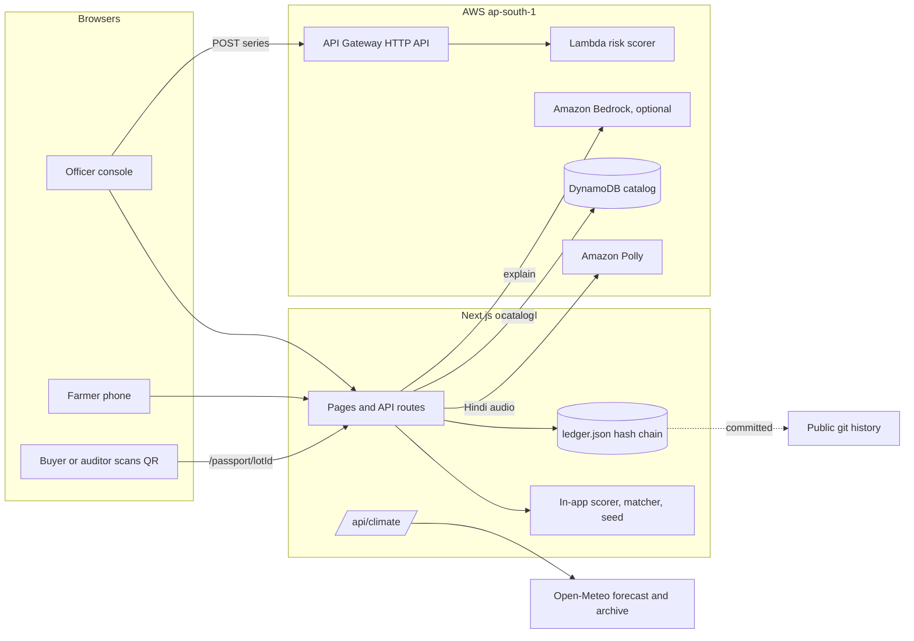

# Kisan Setu: route crop surpluses before they rot

When a harvest surplus crashes the mandi price, farmers dump crop they cannot sell. Small processing units in the same district still have spare weekly capacity. Kisan Setu spots the crash early, routes the surplus to those units, calls the farmer with a price, and gives every rescued lot a tamper evident passport with a QR anyone can verify.

- **Live:** https://kisan-setu-climate.vercel.app
- **Track:** Sustainable Supply Chains (product lifecycle tracking, digital product passports, circular economy)
- **Also touches:** Climate Data and Environmental Monitoring (live Open-Meteo signal), Emissions Transparency (CO2e with cited factors)
- **License:** MIT

## Why this is a climate problem

Food loss and waste generate an estimated 8 to 10% of global greenhouse gas emissions ([UNEP Food Waste Index Report 2024](https://www.unep.org/resources/publication/food-waste-index-report-2024)). A tomato surplus in Kolar is a small, very local version of that: the crop is fine, it just has nowhere to go that week. Every kilo that becomes paste or pickle instead of roadside waste keeps its production emissions from being thrown away.

## What it does

1. **Scores crash risk 0 to 100** from four signals: mandi arrivals surge, price slide, harvest month, and a **climate shock signal** (rain or heat anomaly vs the last 10 years, live from Open-Meteo). Transparent weights, no black box.
2. **Matches surplus to units** by distance and weekly capacity, with a floor price for the farmer.
3. **Calls the farmer** with a spoken offer in Hindi, Kannada or English. Field partners cover farmers without smartphones.
4. **Issues a Surplus Lot Passport** for each accepted lot: canonical JSON, SHA-256 hash chained to the previous lot, a QR code, and a public verify page that recomputes the hash in the browser.
5. **Blocks double counting.** A duplicate guard key (farmer ref, crop, harvest date, unit) means the same physical lot cannot be logged twice, so waste avoided is counted once.
6. **Shows CO2e kept out of waste** with the emission factor and its published source on screen.

## Pages

| Path | What |
|---|---|
| `/` | Story and overview |
| `/admin` | Officer console: risk, Lambda score, climate signal, routing, anchor a lot passport |
| `/field` | Field partner console |
| `/farmer` | Farmer phone with the spoken alert |
| `/flow` | Scripted end to end loop |
| `/passport` | Public ledger, verify the whole chain |
| `/passport/<lotId>` | One lot: record, hash link, QR, verify, tamper test, duplicate test |
| `/passport/verify?p=...` | Verifies a lot carried entirely inside a QR |
| `/impact` | CO2e math, factor sets, sources, limits |
| `/api/ledger` | Ledger as JSON |
| `/api/ledger/check` | POST a record, get 409 if that lot is already anchored |
| `/api/climate` | Climate shock signal for a lat/lng |

## Architecture



### What is deployed

- **AWS Lambda + API Gateway (ap-south-1): live.** `GET https://slmd3nk1lk.execute-api.ap-south-1.amazonaws.com/prod/risk` returns `{"ok":true}`. The officer console POSTs the crop series there and shows "Amazon API Gateway + Lambda" with the score.
- **Next.js app on Vercel: live** at the URL above.
- **Amazon Polly, DynamoDB, Bedrock:** wired in the server routes and enabled by env vars (below). Without them the app falls back to the browser voice, the static seed and a Hindi template, and says so on screen.

### Risk score

```
base    = 0.45 arrivals + 0.40 price + 0.15 season        (Lambda and in-app, kept in sync)
final   = 0.85 base + 0.15 climate                         (app layer, see lib/climate/openMeteo.ts)
climate = max(rainSignal, heatSignal)
rainSignal = clamp((rain_21d / normal_21d - 1) / 2 * 100)  3x normal rain = 100
heatSignal = clamp(tmax_anomaly_C / 4 * 100)               +4 C over normal = 100
```

The 21 day window is the last 14 days observed plus 7 days of forecast, compared with the same calendar window in each of the previous 10 years from the Open-Meteo archive. The deployed Lambda scores the three market signals; the climate blend runs in the app layer, so the Lambda did not need a redeploy.

### Lot passport

```
record   = { lotId, crop, tonnes, village, farmerRef, unit, product, harvestDate,
             routedAt, riskScore, climateSignal, efKgCo2ePerKg, efSource, co2eAvoidedKg, lotKey }
lotKey   = sha256("lot|" + farmerRef + "|" + crop + "|" + harvestDate + "|" + unit)
hash     = sha256(prevHash + "\n" + canonical(record))      first prevHash = 64 zeros
farmerRef = first 16 hex of sha256("farmer|" + farmerId)     no names or phone numbers
```

- The same hashing code (`frontend/src/lib/ledger/core.mjs`) runs in the browser, the server and the CLI.
- The published ledger is `frontend/src/data/ledger.json`. Its git history is the public, append only witness.
- This is a **hash chain**, not a blockchain. There is no consensus, wallet or token. Anchoring the chain head on a public chain is a next step.

Threats it handles: editing a lot after the fact (hash breaks), deleting or reordering lots (links break), logging the same lot twice to inflate impact (duplicate guard, `409` from `/api/ledger/check`). Threats it does not handle on its own: a dishonest operator inventing a lot at the source. That needs a second signature from the unit, which is on the roadmap.

## Climate impact

```
CO2e avoided (kg) = tonnes rerouted x 1000 x EF
```

| Crop | EF, kg CO2e per kg | Source row |
|---|---|---|
| Tomato | 2.09 | Tomatoes |
| Onion | 0.50 | Onions & Leeks |
| Potato | 0.46 | Potatoes |
| Beans, green chilli | 0.53 | Other Vegetables |
| Conservative, all crops | 0.53 | Other Vegetables |
| FAO food wastage average | 2.54 | 3.3 Gt CO2e / 1.3 Gt |

Sources:
- Poore, J. and Nemecek, T. (2018). Reducing food's environmental impacts through producers and consumers. *Science* 360(6392), 987 to 992. Values via [Our World in Data](https://ourworldindata.org/grapher/ghg-per-kg-poore).
- FAO (2013). [Food Wastage Footprint: Impacts on Natural Resources, Summary Report](https://www.fao.org/4/i3347e/i3347e.pdf).
- UNEP (2024). [Food Waste Index Report 2024](https://www.unep.org/resources/publication/food-waste-index-report-2024).
- [Open-Meteo](https://open-meteo.com/) forecast and historical weather APIs.

Limits: factors are global means (the tomato value includes heated greenhouses, so open field Kolar tomatoes are likely lower; the conservative set covers that), processing and transport emissions are not subtracted, avoided methane from rotting is not added, and all tonnages come from the seeded Kolar demo series. Every figure on screen is labeled that way.

## Run it

```bash
cd frontend
npm install
npm run dev            # http://localhost:3000
npm run build
npm run ledger:verify  # recompute every hash in the ledger
npm run ledger:selftest
npm run check:parity   # Lambda scorer matches the in-app scorer
```

Append a lot to the public ledger (refuses duplicates):

```bash
cd frontend
cat > /tmp/lot.json <<'JSON'
{ "farmerId": "KA-KLR-1010", "crop": "tomato", "tonnes": 1.7, "unit": "chintamani-fpo",
  "product": "pickle", "harvestDate": "2026-10-20" }
JSON
npx tsx scripts/ledger.mts append /tmp/lot.json
git add src/data/ledger.json && git commit -m "ledger: anchor lot"
```

## Deploy

**Vercel:** root directory `frontend`, framework Next.js. Set `NEXT_PUBLIC_RISK_API_URL` to the Lambda URL. Optional: `KISAN_AWS_REGION`, `KISAN_AWS_ACCESS_KEY_ID`, `KISAN_AWS_SECRET_ACCESS_KEY` for Polly, DynamoDB and Bedrock, plus `DYNAMODB_TABLE_NAME`, `POLLY_VOICE_ID`, `BEDROCK_MODEL_ID`. Vercel reserves the standard `AWS_*` names, so use the `KISAN_` ones there.

**AWS (SAM):**

```bash
cd aws
sam build
sam deploy --stack-name kisan-setu --region ap-south-1 --capabilities CAPABILITY_IAM --resolve-s3
```

Outputs `RiskApiUrl` and `CatalogTableName`. Seed the table with `npm run seed:dynamo` from `frontend`. The IAM policy for the app server is in `aws/iam-app-policy.json`.

**CI:** a GitHub Actions workflow is in `ci/github-actions-ci.yml`. Copy it to `.github/workflows/ci.yml` to turn it on. It builds the app, verifies the ledger and runs the parity check.

## Env vars

See `frontend/.env.example`. All optional.

| Variable | Purpose |
|---|---|
| `NEXT_PUBLIC_RISK_API_URL` | Lambda risk API. Inlined at build time. |
| `KISAN_AWS_REGION` | Region for Polly, DynamoDB and Bedrock |
| `KISAN_AWS_ACCESS_KEY_ID`, `KISAN_AWS_SECRET_ACCESS_KEY` | Server credentials. Never commit them. |
| `DYNAMODB_TABLE_NAME` | Catalog table |
| `POLLY_VOICE_ID`, `POLLY_ENGINE` | Hindi voice (Kajal neural by default) |
| `BEDROCK_MODEL_ID`, `BEDROCK_REGION` | Optional Hindi explanation |

## Repo map

- `frontend/src/lib/engine` scorer, matcher, seed
- `frontend/src/lib/climate` emission factors with sources, Open-Meteo signal and blend
- `frontend/src/lib/ledger` hash chain core (shared by browser, server, CLI)
- `frontend/src/data/ledger.json` the public ledger
- `frontend/src/app/passport`, `frontend/src/app/impact` passport and impact pages
- `frontend/scripts/ledger.mts` ledger CLI
- `aws/lambda/risk` Lambda scorer, `aws/template.yaml` SAM stack
- `aws/scripts/check-risk-parity.mjs` Lambda vs app parity check
- `backend/` older FastAPI prototype, not used by the deployed app

## Data honesty

Market numbers come from a seeded, real shaped Kolar tomato series so the demo is deterministic. Live mandi snapshots and the climate signal are fetched live. See [DATA-SOURCES.md](DATA-SOURCES.md). Kisan Setu evolved from an earlier prototype of mine; the climate signal, the lot passport and the CO2e layer are new in this version.
